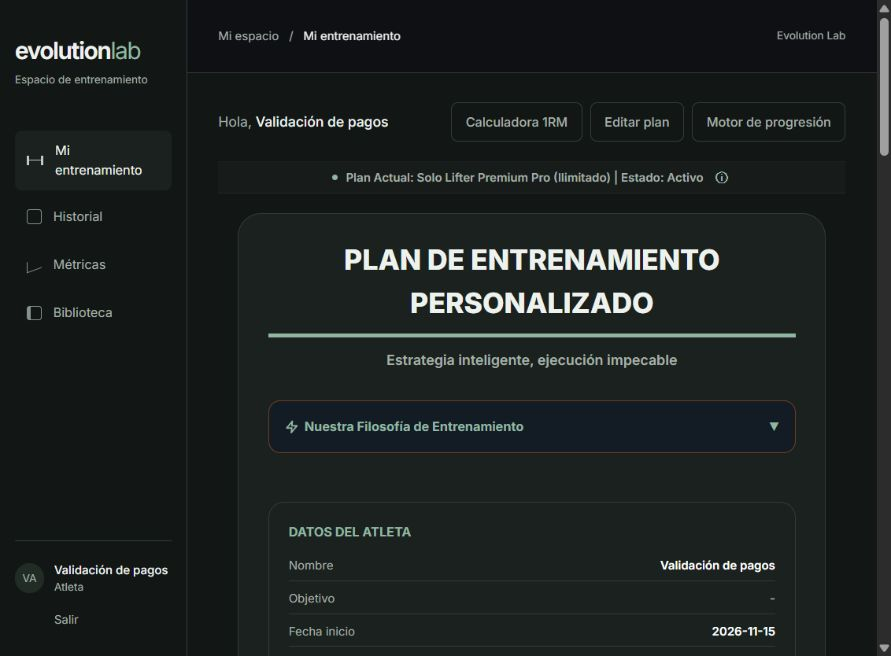
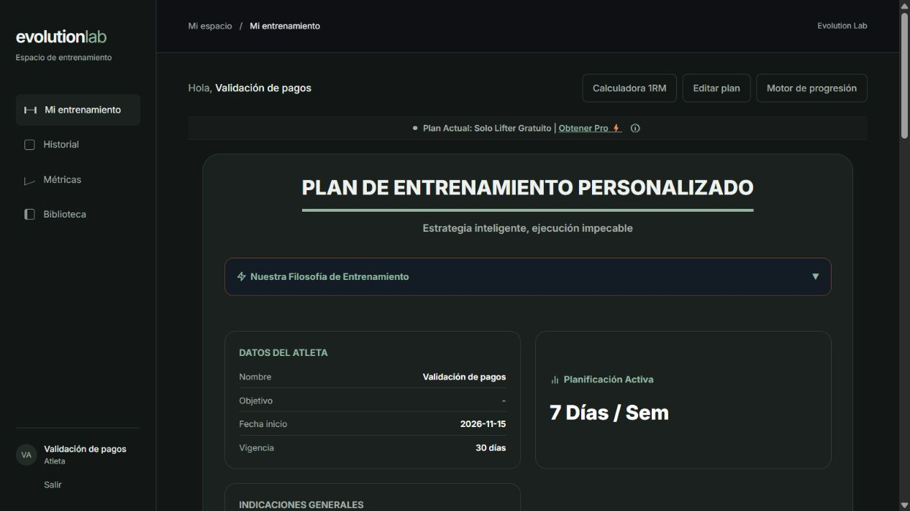

# Validación remota de pagos

El 15 de noviembre se completó el circuito con dos pagos del checkout Sandbox: aprobación, entrega automática del webhook, activación, repetición firmada, renovación anticipada, dos devoluciones totales y retirada de Premium. Un evento controlado con estado obsoleto `approved` tampoco pudo reactivar el acceso. La cuenta sintética quedó inhabilitada, sin sesiones ni tokens de renovación activos; se conservan los dos registros devueltos para trazabilidad y avisos tardíos.

## Entorno preparado

- Supabase: `evolutionlab-restore-check`, sin las cuentas y datos privados copiados de producción. Conserva las políticas de aplicación, el catálogo y los archivos necesarios. La limpieza autorizada y sus verificaciones se describen en [ensayo de restauración](restore-rehearsal.md).
- Vercel: proyecto separado `evolutionlab-sandbox-20261114`, publicado sobre `c6ba328` en [el dominio de pruebas](https://evolutionlab-sandbox-20261114.vercel.app). Vercel informó `Ready`; se comprobó HTTP 200 público y acceso real al panel con la cuenta sintética del Supabase de pruebas.
- Mercado Pago: aplicación `Evolution_Lab_pruebas`. Se comparó de forma privada la credencial mostrada con la local y se confirmó que coinciden. La consulta de `/users/me` exige un vendedor `test_user` de Colombia antes de preparar la configuración.
- El usuario guardó el webhook de pruebas y su clave en el archivo local `.env.payment-sandbox.local`, excluido de Git, e importó las siete variables en el proyecto Vercel de pruebas. Se comprobaron los nombres y entornos guardados, el rechazo del checkout sin JWT (401), el rechazo de firmas ausentes/falsas (401) y la coincidencia de la firma local con la configurada (200 con ID ficticio, sin escribir en el ledger). Las claves y contraseñas de mantenimiento de PostgreSQL no se desplegaron.

El simulador oficial de `Evolution_Lab_pruebas` envió `payment.updated`, con ID ficticio `123456` y `live_mode: false`, al dominio del sandbox y recibió `200 - OK`. Después se completaron dos compras desde el checkout Sandbox y se comprobó su aplicación automática en el ledger.

La primera preferencia remota pasó la comprobación de 19.900 COP, identidad del JWT y URLs de retorno/notificación del sandbox. Se verificó la correspondencia entre el vendedor `test_user`, la credencial que muestra el panel y la aplicación de ejecución de la preferencia. En esta ejecución el ID de aplicación del panel y el `client_id` de la preferencia son distintos: no se sustituyó esa comprobación por aceptar cualquier vendedor o aplicación. Mercado Pago documenta que [Checkout Pro genera automáticamente un vendedor de pruebas y utiliza sus credenciales](https://www.mercadopago.com.co/developers/es/docs/checkout-pro-preferences/test-accounts).

No se cambiaron tarifas ni credenciales de la plataforma de producción. Los pagos de prueba deben conservar los importes del catálogo del servidor y utilizar comprador y medios de pago de prueba.

## Resultado del 15 de noviembre

Las horas de esta tabla corresponden a Colombia (UTC−5).

| Comprobación | Resultado observado |
| --- | --- |
| Primera aprobación | 19.900 COP; aprobada a las 14:12:45; un registro de pago y Premium activo hasta el 15 de diciembre a las 14:12:45 |
| Entrega automática | El registro y la activación existían antes de enviar cualquier reenvío manual para ese pago |
| Repetición | Tras consultar el estado actualizado del proveedor, el reenvío firmado recibió `duplicate: true`, `updated: false`; ledger, suscripción y vencimiento coincidieron exactamente con la línea base |
| Renovación anticipada | Segunda compra de 19.900 COP a las 14:24:22; dos pagos únicos; vencimiento el 14 de enero de 2027 a las 14:12:45, exactamente 30 días adicionales |
| Interfaz | El panel real de la cuenta sintética mostró `Solo Lifter Premium Pro (Ilimitado) / Estado: Activo` |
| Primera devolución total | Realizada por el operador desde la cuenta del vendedor de pruebas; API y ledger en `refunded`; Premium siguió activo solo por la segunda compra, hasta el 15 de diciembre a las 14:24:22 |
| Segunda devolución total | Ambas operaciones en `refunded`; plan `free`, estado `cancelado`, suscripción cancelada y referencia de pago activo vacía |
| Evento obsoleto | Dos avisos firmados controlados con estado `approved` y fecha antigua recibieron `duplicate: true`, `updated: false`; ambos pagos siguieron devueltos y Premium no se reactivó |
| Cierre de la cuenta | Inhabilitación autorizada, cierre global, cero sesiones y cero tokens de renovación activos; nuevo acceso rechazado; retirada de copias locales de contraseñas |

La repetición y los eventos obsoletos se enviaron con la herramienta de mantenimiento y una firma HMAC válida, consultando el pago real del proveedor. La entrega inicial, la renovación y los avisos de ambas devoluciones fueron automáticos desde Mercado Pago. Los comprobantes privados excluidos de Git conservan los IDs y resultados; no incluyen claves ni contraseñas.

En estas dos operaciones, la API devolvió `live_mode: true` aunque el checkout y el comprobante mostraron Sandbox. Ese valor se conserva en la evidencia. El verificador exige además el vendedor marcado `test_user`, la preferencia verificada del entorno aislado, la identidad sintética, el importe/moneda y los datos de aprobación ficticios `APRO` y descriptor `fake`. No se sustituye esa comprobación por aceptar cualquier pago con `live_mode: true`.

La credencial de la aplicación rechazó dos intentos de crear el primer reembolso con HTTP 401, código 7, `Unauthorized use of live credentials`; se reutilizó la misma clave de idempotencia. Las dos devoluciones se completaron desde la cuenta del vendedor ficticio, y después se verificaron mediante la API y el webhook. Por tanto, queda validado el procedimiento de devolución del operador desde Mercado Pago; no se afirma que esa credencial permita automatizar la creación de reembolsos por API. Los estados del ledger no se editaron manualmente.

La cuenta sintética y su perfil gratuito inhabilitado se conservan con los dos registros devueltos para que los reintentos tardíos sigan siendo idempotentes. Las demás cuentas desechables de accesos e integración se eliminaron. Las copias locales de las contraseñas del ensayo de pagos se retiraron tras comprobar la revocación de sesiones.

El propietario confirmó que `MERCADOPAGO_ACCESS_TOKEN` del proyecto principal `evolution-lab3-0-main` corresponde a Credenciales productivas de `EvolutionLab`. Se registró esa confirmación sin leer ni guardar el valor productivo. La firma del webhook principal ya había pasado la notificación auténtica del simulador oficial.

## Evidencia de interfaz

Plan activo después de la aprobación y la renovación:

Plan gratuito después de ambas devoluciones y de comprobar los eventos obsoletos:

## Pasos para cerrar el circuito

1. **Completado:** guardar el webhook de `Evolution_Lab_pruebas`, con el evento de pagos y la URL del sandbox, e importar sus variables en el Vercel separado.
2. **Completado:** desplegar el código verificado, comprobar acceso con Supabase de pruebas, firmas rechazadas y una notificación genuina del simulador oficial.
3. **Completado:** crear la identidad sintética, comprobar el checkout y completar la primera compra desde una sesión de comprador separada.
4. **Completado:** comprobar la aprobación mediante la API del proveedor y su aplicación automática en `payment_ledger` y la suscripción.
5. **Completado:** repetir la notificación con firma válida y comparar el estado duradero; completar una segunda compra antes del vencimiento y comprobar 30 días adicionales.
6. **Completado:** efectuar las dos devoluciones totales desde el vendedor de pruebas y comprobar sus avisos automáticos; verificar primero la compra restante y después la retirada de Premium.
7. **Completado:** comprobar que los eventos obsoletos no restauran el acceso, cerrar las sesiones e inhabilitar la cuenta con autorización; retirar las copias locales de contraseñas y conservar el ledger devuelto como evidencia.

El endpoint productivo también aceptó una notificación firmada auténtica del simulador de la aplicación principal, con ID ficticio y modo de prueba, sin crear pagos ni registros en el ledger. Esa evidencia se conserva separada de los dos pagos comprobados en el proyecto aislado.
